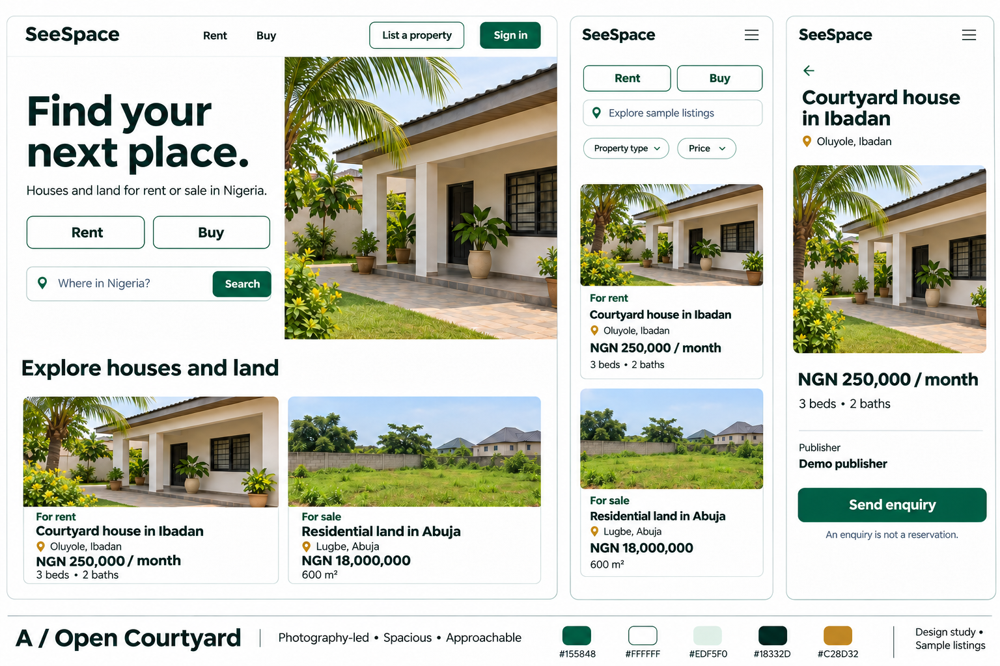
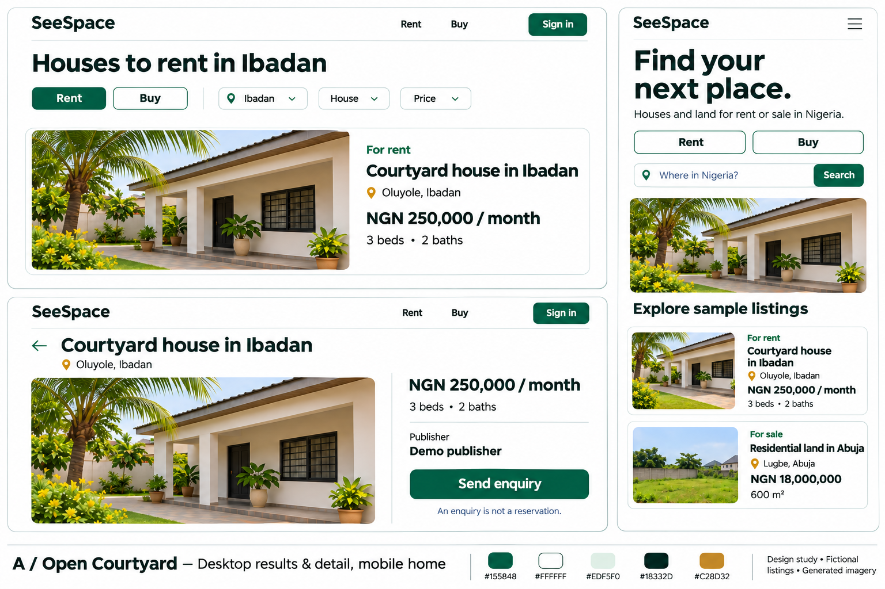
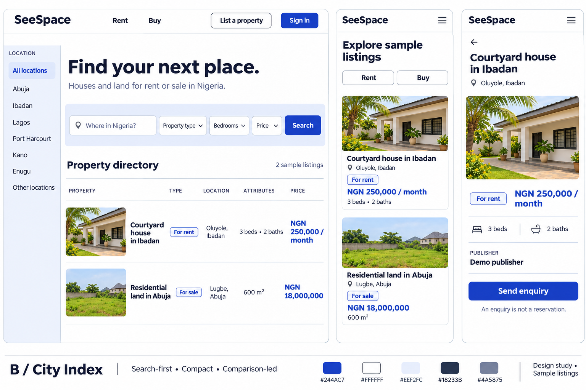
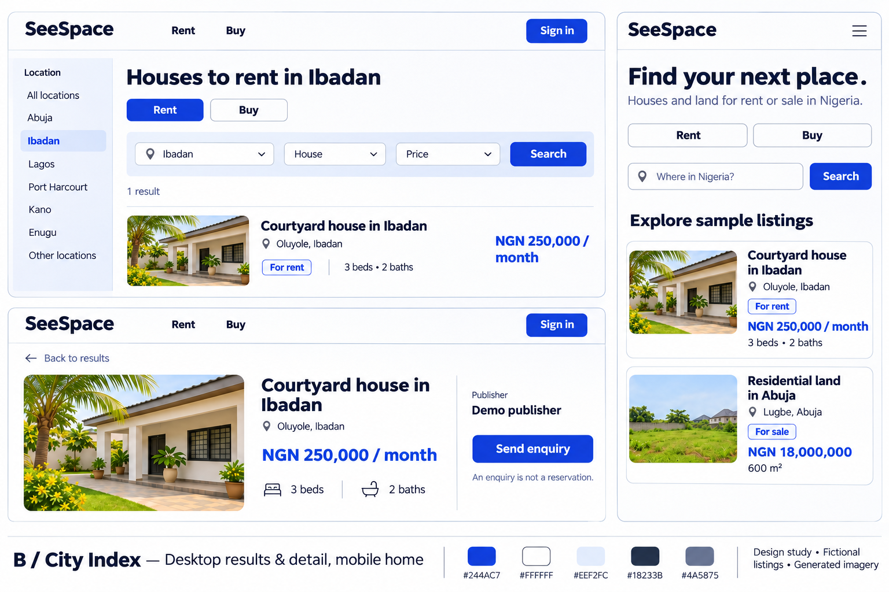

# SeeSpace Phase 1: visual direction review

12 November 2026 · M1 review candidate · **Selection pending: Aminu**

Open [the review board](review.html) locally, or view the four PNGs below. These are static, generated design probes with fictional listings, not a working prototype. No application logic, routes, authentication, dependencies or database were changed.

## Two directions, one comparison

|              | A: Open Courtyard                                                               | B: City Index                                                                             |
| ------------ | ------------------------------------------------------------------------------- | ----------------------------------------------------------------------------------------- |
| Primary idea | Give a home and its surroundings room to explain themselves                     | Make location, purpose and amounts quick to compare                                       |
| Homepage     | Split search and large courtyard photograph                                     | Search band, location rail and compact inventory rows                                     |
| Results      | Large landscape image alongside a short listing summary                         | Smaller image, aligned data and price columns                                             |
| Detail       | Gallery leads; price and enquiry sit alongside                                  | Facts lead; compact image and separate enquiry column                                     |
| Mobile       | Search first, image next, then stacked inventory                                | Search immediately followed by compact inventory; desktop rail becomes location control   |
| Strength     | Approachable first impression; supports occasional seekers and visual discovery | Fast repeat browsing; accommodates larger inventory without a long homepage               |
| Tradeoff     | More image bandwidth and scrolling; image quality matters                       | Denser titles/prices need careful wrapping; can feel administrative if the rail dominates |

**Recommendation, not selection:** A, Open Courtyard. Its generous photography and clear purpose controls fit the source brief's welcoming public marketplace. B is a credible alternative when fast comparison is the stronger priority. Do not blend these automatically; Aminu should select a named direction or request a specific revision.

The physical context is a seeker browsing on a phone in bright daytime light, deciding whether an unfamiliar listing is worth an enquiry. Both use high-contrast light surfaces. A's reference object is a shaded residential courtyard; B's is a readable property directory. The composition choices differ in hierarchy and density, not only color. The default beige luxury-property treatment was rejected in favor of true white and functional information.

## Reviewable screens

| Direction | Desktop home; mobile overview and detail      | Desktop results and detail; mobile home           |
| --------- | --------------------------------------------- | ------------------------------------------------- |
| A         | [Overview board](open-courtyard-overview.png) | [Responsive board](open-courtyard-responsive.png) |
| B         | [Overview board](city-index-overview.png)     | [Responsive board](city-index-responsive.png)     |

The paired boards cover P01 home, a P02 rental-results composition and P03 house-rental detail at desktop/mobile conceptual sizes. Mixed sample overviews are discovery examples, not filtered rental results. Filtered rental boards contain only the rental house. Image lettering and proportions are illustrative, not pixel specifications or evidence of tested responsive breakpoints.

## Shared sample content and provenance

| Design-study fixture      | Public area     | Purpose and asking amount  | Attributes                       |
| ------------------------- | --------------- | -------------------------- | -------------------------------- |
| Courtyard house in Ibadan | Oluyole, Ibadan | Rent; NGN 250,000 / month  | 3 bedrooms, 2 bathrooms          |
| Residential land in Abuja | Lugbe, Abuja    | Sale; NGN 18,000,000 total | 600 m²; no bedrooms or bathrooms |

These two fictional design-study records are identical across directions. City/area names are geographical illustration, not approved launch coverage, exact addresses or claims of actual inventory. All prices are invented and are not market quotations. Currency, rent periods and location precision remain D01/D03/D07 decisions. No real contacts, occupants, owners, mandates or testimonials are included. “Demo publisher” is fictional.

The source brief's SS101–SS106 fixtures remain unchanged. These visual-study aliases and sale amount are **not replacements for that canonical M2 fixture set**. M2 should use the source fixture set, including the additional house-sale, land, unavailable, draft and rejection cases. The real-city labels and the extra city rail in B are proposals only; the source brief's Demo City convention remains the safe default until reviewed. The B rail must be data-driven, not a promise of city coverage.

All four boards and the architectural/land images within them were generated for this task by OpenAI image generation on 12 November 2026. No stock image, scraped occupied-home photograph, external logo or third-party font file was downloaded. B and both companion boards used A's generated imagery as a reference. These are illustrative scenes, not evidence of any property. Production inventory must replace them with authorized real listing media. Original generation outputs remain locally under `generated_images/`; only reviewed copies under this folder are part of the scoped deliverable.

## Proposed design tokens, not approved branding

| Semantic role          | A: Open Courtyard                                 | B: City Index                 |
| ---------------------- | ------------------------------------------------- | ----------------------------- |
| Surface                | #FFFFFF                                           | #FFFFFF                       |
| Secondary surface      | #EDF5F0                                           | #EEF2FC                       |
| Text                   | #18332D                                           | #18233B                       |
| Primary action / focus | #155848                                           | #244AC7                       |
| Secondary text         | #18332D                                           | #4A5875                       |
| Decorative accent      | #C28D32; never small text or a sole status signal | None                          |
| Error                  | #8F2828 plus explicit message                     | #8F2828 plus explicit message |
| Warning                | #93401F plus explicit message                     | #93401F plus explicit message |
| Success                | #155848 plus explicit message                     | #155848 plus explicit message |

Hex values are portable review swatches; convert to semantic OKLCH tokens when the selected system is implemented. Generated pixels do not establish exact token values. Calculated contrast against white: A primary 8.33:1; A text 13.55:1; B primary 7.29:1; B text 15.64:1; B secondary text 7.13:1. Recheck rendered states in M2; these calculations are not a complete accessibility audit.

Proposed type: A uses Public Sans with generous weight contrast; B uses Source Sans 3 with a more compact scale and tabular amounts. Both are proposals, not fonts installed by this task; availability, licensing and the exact webfont subset remain to be checked in M2. The raster probes approximate a humanist sans and are not authoritative font specimens. Preserve existing Instrument Sans and component styling on real auth/settings/team pages until explicitly integrated.

Proposed scales: 16 px body, 14 px metadata, 20/24/32 px section headings; A 56 px desktop/36 px mobile home title, B 40/32 px. Use 4/8 px spacing; A section gaps 48–64 px and 12 px card radii; B 24–32 px and 6 px radii. Prefer 4:3 listing images and a wider detail crop with a full-gallery path. Generated boards vary crops to explore composition, not to override source media ratios. Keep text below images, not on busy photos.

## Behavior and shell proposal for the selected direction

- Public shell: logo/home, Rent, Buy, List a property, Sign in. No team navigation or signup wall. The existing `app.ts` defaults to AppLayout, so M2 needs an explicit public layout rule. This task does not add it.
- Publisher shell: private My listings, Enquiries and account context. Operations shell: review queue, reports and decisions. Reuse existing auth, security, settings and teams; do not infer landlord, agent or moderator privileges from Owner/Admin/Member.
- On mobile, stack fields and use a labelled menu and filter sheet. At 768 px, collapse location/filter rails; at 1440 px, bound content width and split detail/gallery and enquiry. The raster hamburger is a probe shorthand: the implementation must provide a visible Menu label and an accessible name.
- Rent and Buy have equal entry prominence. Selecting purpose creates a scoped result set. Land hides residential filters. Sorting only compares compatible currency and rent periods. Filter sheet dismissal preserves applied values; Apply, Reset, Clear all and Back behavior belong to M2.
- Detail uses the selected record's public fields; “Send enquiry” opens a form showing the recipient. It never reserves, books, charges or confirms a viewing. Include description, availability, known charges, gallery, report action and honest missing-image fallback in M2; the boards intentionally show only the composition's core.
- Focus: 2 px action-color outline with 2 px white separation; 44 px targets; no color-only statuses. Inactive controls, hover, selected, busy, validation and error states require implementation review. No autoplay or entrance choreography; use 150–200 ms state transitions with reduced-motion alternatives.

## Requirements and approval boundary

| Evidence in this review                                       | Requirement / source                       | What it does not prove                                      |
| ------------------------------------------------------------- | ------------------------------------------ | ----------------------------------------------------------- |
| Rent and Buy, public discovery shell                          | Confirmed BO001, FR001; P01                | Working guest routes or auth integration                    |
| Location/purpose and appropriate house/land summaries         | Proposed FR002–FR004, BR002–BR003; P02/P03 | Filtering, pagination, persistence, data integrity          |
| Publisher and nonbinding enquiry copy                         | Proposed FR013, BR004, D07                 | Form, consent, delivery or recipient authorization          |
| No verification, payment or private account records in boards | Proposed BR005, SP001, D06/D08/D09         | Server isolation or security acceptance                     |
| Desktop/mobile compositions and token contrast calculations   | Proposed NFR001/NFR002                     | WCAG compliance, 360/768/1440 app tests or complete F01–F07 |

Confirmed scope: SeeSpace branding, Nigeria-first, houses and land, public rent/sale browsing, Codex-only workflow in the existing scaffold. The original BRS remains a draft; its proposed policies and D01–D12 remain open. M0 is partial, M1 is awaiting selection, M2–M7 are not started by this task. Phase 1 visual exploration is not BRS P1 marketplace completion.

## Source record and publication review

The unchanged [BRS v1.1 DOCX](../../SeeSpace_Business_Requirements_Specification_v1_1.docx) is now in `docs/`. It was materialized from the supplied Library ID, verified as a readable ZIP/DOCX on this Mac, and inspected for text, metadata, relationships, custom XML and embedded thumbnail. Source size: **58,793 bytes**. SHA-256: `aa0c9fb127fd31f27ef4c7d1da479a69ad55423eb09839f927fbfdc89ffef0d4`.

No credentials, private contact details, tenant records, private financial data or embedded executable content were found. The author metadata is “Anis”; the thumbnail is blank; custom XML is an empty bibliography; links reference the public legacy repository. Generic 2013 template timestamps and page-count metadata are not the document's issue date. No source bytes were altered or silently redacted. The old Claude/fresh-build wording is preserved as historical source; the later Codex-only/existing-scaffold instructions take precedence. Legacy static source findings are not findings proven against this new scaffold.

Source BRS Library ID: `libfile_fde3_f-d9774332f7048191bc5ffcdba1db6f64_df41132c386c8191b1a0cecc1c16ef11`, version 0. The UI/UX design brief v1.1 was read in full from Library: `libfile_fde3_f-3b61f19917b08191851254b26f8847d3_df41132c386c8191b1a0cecc1c16ef11`, version 0. It was not copied into this repository. No legacy prototype code was imported.

## Verification and next decision

All four generated boards were visually inspected. The first A probe's active Rent state incorrectly accompanied mixed inventory; the reviewed A overview corrects this and adds explicit purpose labels. Both filtered-rental boards now show only the house. Checked matching titles, amounts and attributes, no land-bedroom fields, no sale rent suffix, no unsupported verification/payment claims, and recognizable mobile composition.

Remaining probe limitations: small raster copy cannot stand in for 360 px implementation; B's dense desktop row wraps the amount and needs a minimum price-column width; A's mobile overview uses a search-shaped heading, which should become a plain heading plus a properly labelled location field; some generated swatch shades are approximate. These are explicitly implementation notes, not defects hidden by an acceptance claim. No complete gallery, enquiry form, unavailable/error states, land-sale detail or publisher/operations flow has been built.

The [progress ledger](../../plans/SeeSpace-Progress-2026-11-12.md) records commands actually run, evidence and remaining gates. Aminu's next decision is **A, B, or a requested revision**. Selection must record the chosen direction and any changes to density, imagery, palette or type before M2 starts.
